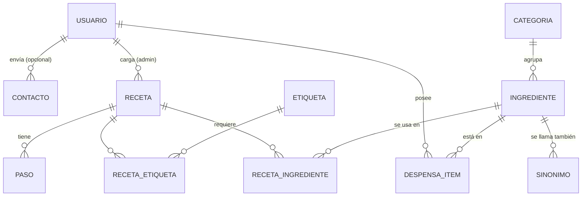

# Modelo de datos

Estructura completa en `database/schema.sql`; datos de ejemplo en `database/seed.sql`; recetario en `database/recetas/*.json` → `database/recetas.sql`.
Responsable: P3.

## Tablas que usa el incremento 1

| Tabla | Para qué | Relaciones |
|---|---|---|
| `usuario` | Cuentas. `rol` = `general` o `admin`. `hash_contrasena` con `password_hash()`. `color` = color de la heladera elegido (`verde`, `crema`, `celeste`, `rosa`, `noche`). `disposicion` = `normal` o `panoramica`. `volumen` = 0 a 100 (sonidos) | — |
| `contacto` | Consultas del formulario de contacto. `respuesta`, `respondida_en` y `respuesta_enviada`: la respuesta de la administración (DEC-007) | `usuario_id` → usuario (NULL si no estaba logueado; `ON DELETE SET NULL`) · `respondida_por` → usuario (`ON DELETE SET NULL`) |
| `receta` | Contenido principal del sitio | `autor_id` → usuario (`ON DELETE SET NULL`) |
| `receta_ingrediente` | Ingredientes de cada receta, con cantidad y unidad. `peso` = 3 principal, 2 secundario, 1 accesorio (para el puntaje, DEC-008). `es_opcional` no cuenta para el puntaje. `nota` = "picado", "para servir"… | → receta (`CASCADE`), → ingrediente |
| `paso` | Pasos numerados de cada receta. `instruccion` puede tener marcadores `{ing:papa}` que se reemplazan por la cantidad escalada; `segundos_timer` = temporizador del paso (modo cocina) | → receta (`CASCADE`) |
| `etiqueta` · `receta_etiqueta` | Vegetariana, sin TACC, económica, dulce | → receta, → etiqueta |
| `sustitucion` | "Si falta X, podés usar Y" (manteca → aceite). Cuenta como medio ingrediente en el puntaje (DEC-008) | `ingrediente_id` y `reemplazo_id` → ingrediente |
| `categoria` · `ingrediente` · `sinonimo` | Catálogo de ingredientes y nombres alternativos (palta = aguacate). `ingrediente.usuario_id` NULL = lista general; con un usuario = ingrediente propio que agregó desde su despensa (DEC-006) | ingrediente → categoria · ingrediente → usuario (`CASCADE`) |
| `despensa_item` | Lo que tiene cada usuario: nivel, vencimiento y ubicación | → usuario (`CASCADE`), → ingrediente |

## Incremento 2

- **Entrega A (hecha):**
  - Se usan `receta_ingrediente.peso`, `nota`, `paso.segundos_timer` y la tabla `sustitucion`.
- **Entrega B (hecha):**

| Tabla | Para qué | Se usa en |
|---|---|---|
| `usuario_basico` | "Siempre tengo": cuenta como disponible y no se descuenta al cocinar (DEC-012) | Mis preferencias, recomendación, catálogo, modo cocina |
| `restriccion_usuario` | "No puedo comer": esas recetas no se recomiendan (DEC-012) | Mis preferencias, recomendación, catálogo |
| `favorito` | Recetas marcadas con ♥ (DEC-012) | Detalle, catálogo, Mis preferencias, API |
| `sesion_cocina` · `paso_completado` | La receta que se está cocinando y los pasos hechos; `stock_descontado` evita descontar dos veces (DEC-011) | Modo cocina, Mi cocina, puntaje (−8 si se cocinó hace poco) |
| `recuperacion` (nueva) | Enlaces de "Olvidé mi contraseña": hash del token, vence en 1 hora, un solo uso (DEC-013) | `olvide.php`, `restablecer.php` |
| `intento_ingreso` (nueva) | Ingresos fallidos por email, para el bloqueo de 15 minutos (DEC-014) | Ingreso (página y API) |
| `receta.imagen` | Ruta de la foto de la receta, dentro de `public/img/recetas/` (DEC-015) | Editor y detalle de la receta, API |

Migración para bases existentes: `database/migraciones/006-incremento-2-b.sql`.

## Reglas importantes

- No se puede borrar un ingrediente que usa alguna receta o despensa (la clave foránea lo impide y la página lo avisa).
- Al borrar una receta se borran solos sus ingredientes, pasos y etiquetas (`ON DELETE CASCADE`).
- Un usuario no puede tener dos veces el mismo ingrediente en la misma ubicación (`UNIQUE (usuario_id, ingrediente_id, ubicacion)`).
- El nombre de un ingrediente no se repite en la lista general ni entre los propios de un mismo usuario (`UNIQUE (nombre, ambito)`, donde `ambito` = `usuario_id` o 0).
- Las búsquedas ignoran tildes y mayúsculas gracias al cotejamiento `utf8mb4_unicode_ci` ("morron" encuentra "Morrón").
