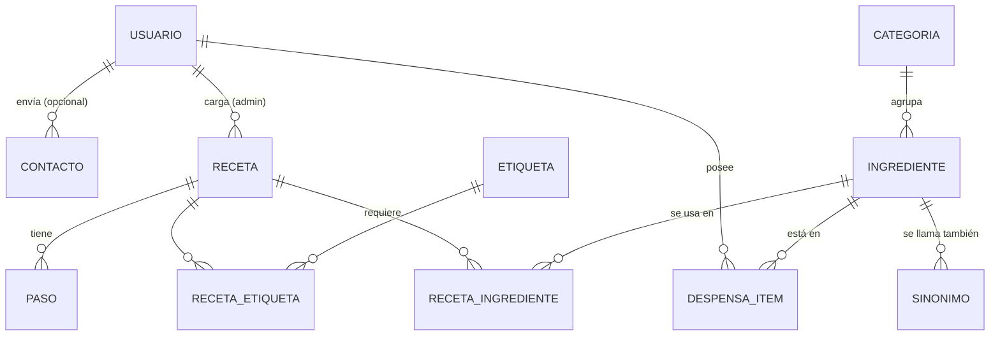

# Modelo de datos

Estructura completa en `database/schema.sql`; datos de ejemplo en `database/seed.sql`.
Responsable: P3.

## Tablas que usa el incremento 1

| Tabla | Para qué | Relaciones |
|---|---|---|
| `usuario` | Cuentas. `rol` = `general` o `admin`. `hash_contrasena` con `password_hash()`. `color` = color de la heladera elegido (`verde`, `crema`, `celeste`, `rosa`, `noche`). `disposicion` = `normal` o `panoramica`. `volumen` = 0 a 100 (sonidos) | — |
| `contacto` | Consultas del formulario de contacto. `respuesta`, `respondida_en` y `respuesta_enviada`: la respuesta de la administración (DEC-007) | `usuario_id` → usuario (NULL si no estaba logueado; `ON DELETE SET NULL`) · `respondida_por` → usuario (`ON DELETE SET NULL`) |
| `receta` | Contenido principal del sitio | `autor_id` → usuario (`ON DELETE SET NULL`) |
| `receta_ingrediente` | Ingredientes de cada receta, con cantidad y unidad | → receta (`CASCADE`), → ingrediente |
| `paso` | Pasos numerados de cada receta | → receta (`CASCADE`) |
| `etiqueta` · `receta_etiqueta` | Vegetariana, sin TACC, económica | → receta, → etiqueta |
| `categoria` · `ingrediente` · `sinonimo` | Catálogo de ingredientes y nombres alternativos (palta = aguacate). `ingrediente.usuario_id` NULL = lista general; con un usuario = ingrediente propio que agregó desde su despensa (DEC-006) | ingrediente → categoria · ingrediente → usuario (`CASCADE`) |
| `despensa_item` | Lo que tiene cada usuario: nivel, vencimiento y ubicación | → usuario (`CASCADE`), → ingrediente |

Las tablas `usuario_basico`, `restriccion_usuario`, `sustitucion`, `favorito`, `sesion_cocina` y `paso_completado` ya existen pero se usan recién en el incremento 2.

## Reglas importantes

- No se puede borrar un ingrediente que usa alguna receta o despensa (la clave foránea lo impide y la página lo avisa).
- Al borrar una receta se borran solos sus ingredientes, pasos y etiquetas (`ON DELETE CASCADE`).
- Un usuario no puede tener dos veces el mismo ingrediente en la misma ubicación (`UNIQUE (usuario_id, ingrediente_id, ubicacion)`).
- El nombre de un ingrediente no se repite en la lista general ni entre los propios de un mismo usuario (`UNIQUE (nombre, ambito)`, donde `ambito` = `usuario_id` o 0).
- Las búsquedas ignoran tildes y mayúsculas gracias al cotejamiento `utf8mb4_unicode_ci` ("morron" encuentra "Morrón").
